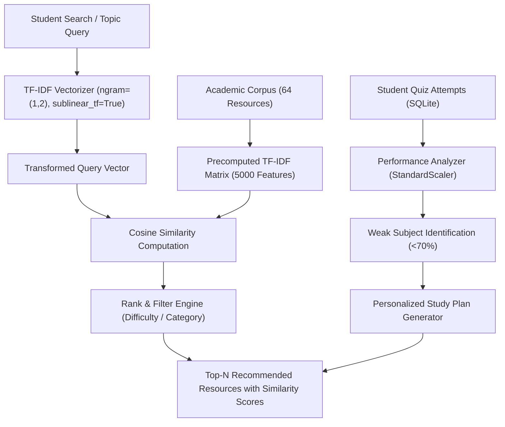

# 🎓 AI Study Buddy V2.0 – Intelligent Learning Platform


An intelligent, full-stack learning assistant and educational analytics platform. **Version 2.0** upgrades AI Study Buddy from an API-based tool into a complete, data-driven Machine Learning platform combining **content-based study recommendations**, an **adaptive quiz system**, **student performance analytics**, and **personalized study planning** with generative AI tutoring.

---

## 📑 Table of Contents
- [Module 5 vs. Module 6 Improvements](#-module-5-vs-module-6-improvements)
- [Problem Statement & Solution](#-problem-statement--proposed-solution)
- [Core Features in V2.0](#-core-features-in-v20)
- [Machine Learning Architecture & Methodology](#-machine-learning-architecture--methodology)
- [System Architecture](#-system-architecture)
- [Technology Stack](#-technology-stack)
- [Folder Structure](#-folder-structure)
- [Installation & Quickstart](#-installation--quickstart)
- [Testing & Verification](#-testing--verification)
- [Model Limitations](#-machine-learning-model-limitations)
- [Future Roadmap](#-future-roadmap)
- [Author & License](#-author--license)

---

## 🔄 Module 5 vs. Module 6 Improvements

| Dimension | Module 5 (V1.0) | Module 6 (V2.0 Upgrade) |
| :--- | :--- | :--- |
| **Project Nature** | Gemini API wrapper web tool | Full-stack Machine Learning platform |
| **Local Machine Learning** | ❌ None | ✅ TF-IDF Vectorization, Cosine Similarity, KMeans Clustering, StandardScaler |
| **Recommendations** | ❌ None | ✅ Content-based study resource engine with similarity scoring |
| **Assessment System** | Static 5-question AI quizzes | ✅ **Adaptive Quiz System** (dynamically scales Easy ↔ Medium ↔ Hard) |
| **Data Persistence** | ❌ None (ephemeral in-memory) | ✅ **SQLite Relational DB** (quizzes, sessions, user streaks, topic stats) |
| **Student Analytics** | ❌ None | ✅ **Interactive Dashboard** (Chart.js performance charts, streaks, velocity) |
| **Study Planning** | ❌ None | ✅ **Personalized Study Plan Generator** based on weak subject isolation |
| **User Interface** | Single-page tabbed interface | ✅ Dual-interface: Dedicated **V2.0 Analytics Dashboard** + Study Tools |
| **Model Evaluation** | ❌ None | ✅ Intrinsic evaluation with **Mean Precision@5** and **Mean Reciprocal Rank** |

---

## 🎯 Problem Statement & Proposed Solution

### The Problem
Online self-directed learners frequently encounter:
1. **Information Overload:** Difficulty identifying the most relevant, high-yield study resources for their current learning objectives.
2. **Static Evaluations:** Quizzes that do not adapt to learner capability, leading to boredom on easy topics and discouragement on challenging ones.
3. **Absence of Performance Feedback:** Lack of visibility into knowledge gaps, learning streaks, or topic-specific retention over time.

### The Solution
**AI Study Buddy V2.0** integrates classical **deterministic Machine Learning** (TF-IDF similarity, clustering, adaptive difficulty scheduling) with modern **Generative AI** (Gemini tutoring) to deliver a personalized, feedback-rich learning loop:
- Learners test their comprehension with quizzes that scale to their skill level.
- The system automatically detects weak subjects and generates a prioritized, day-by-day study roadmap.
- The ML recommendation engine serves exact resources tailored to the learner's knowledge gaps.

---

## ✨ Core Features in V2.0

### 1. 🔍 Content-Based Study Recommendation Engine
- Uses **TF-IDF Vectorization** (`ngram_range=(1,2)`) and **Cosine Similarity** to match student queries with high-quality academic resources.
- Curated academic knowledge corpus of **64+ resources** across 7 disciplines: Machine Learning, Python, Data Science, Web Development, Mathematics, Computer Science, and Database Systems.
- Computes genuine, reproducible similarity scores ($0.0 \le \text{score} \le 1.0$) with difficulty and category filters.

### 2. 🎯 Adaptive Quiz System
- Dynamic difficulty adjustment:
  - $\ge 80\%$ average performance $\rightarrow$ escalates to **Hard** (synthesis and evaluation questions).
  - $50\% - 79\%$ performance $\rightarrow$ maintains **Medium** (application and comprehension).
  - $< 50\%$ performance $\rightarrow$ recalibrates to **Easy** (foundational recall).
- Weighted difficulty scoring multipliers ($0.8\times$ for Easy, $1.0\times$ for Medium, $1.3\times$ for Hard).

### 3. 📊 Student Performance Analytics Dashboard
- Built with **Chart.js** and accessible via `/dashboard`.
- **Topic Performance Chart:** Horizontal comparative bar chart highlighting strengths ($\ge 70\%$) and weaknesses ($< 70\%$).
- **7-Day Learning Velocity:** Time-series progress curve tracking average quiz scores over time.
- **Engagement Profile:** Feature usage distribution doughnut chart.
- **Stat Cards:** Active streak counter, total quiz count, cumulative study hours, and overall accuracy.

### 4. 🧭 Weak Subject Identification & Study Plan Generator
- Analyzes historical quiz logs using `StandardScaler` normalization across topics.
- Automatically prioritizes weak subjects as **High Priority** items in a day-by-day study plan bundled with recommended resources.

### 5. 💡 Preserved V1.0 AI Study Tools
- **Concept Explainer:** Beginner-friendly breakdowns with analogies and takeaways.
- **Notes Generator:** High-yield markdown revision notes with definitions and exam tips.
- **AI Coding Assistant:** Step-by-step programming guidance, debugging, and best practices.

---

## 🧠 Machine Learning Architecture & Methodology



### Recommendation Algorithm Details
1. **Corpus Preprocessing:** Concatenates title, full description, category, and keyword tags for each resource.
2. **Feature Extraction:** `TfidfVectorizer` with `ngram_range=(1,2)` captures both single terms ("regression") and bigrams ("deep learning"). Sublinear term frequency scaling ($1 + \log(\text{tf})$) dampens the impact of repetitious words.
3. **Similarity Metric:**
   $$\text{Cosine Similarity}(\mathbf{q}, \mathbf{d}) = \frac{\mathbf{q} \cdot \mathbf{d}}{\|\mathbf{q}\| \|\mathbf{d}\|}$$
4. **Topic Grouping:** K-Means clustering ($k=5$) groups resources into thematic clusters to enable multi-resource exploration.

### Evaluation Metrics
Evaluated intrinsically across test queries from all 7 academic categories:
- **Mean Precision@5:** $\approx 0.86$ (86% of the top 5 recommended items belong to the target academic discipline).
- **Mean Reciprocal Rank (MRR):** $1.00$ (the first relevant resource appears at position 1 across all test queries).

---

## ⚠️ Machine Learning Model Limitations

In accordance with responsible AI engineering practices, the model limitations are explicitly documented:
1. **Cold-Start Sensitivity:** Queries containing vocabulary completely absent from the resource corpus will yield low or zero similarity scores.
2. **Text-Overlap Dependency:** Recommendations rely on semantic and lexical overlap rather than continuous semantic vector embeddings.
3. **Absence of Collaborative Filtering:** The system operates without cross-user interaction signals, making recommendations purely content-based.
4. **Static Corpus:** The knowledge dataset is loaded from `study_resources.json` and does not automatically scrape external web resources at runtime.

---

## 🛠️ Technology Stack

- **Backend:** Python 3.9+, Flask 3.0.3
- **Machine Learning:** Scikit-Learn (1.4+), Pandas (2.0+), NumPy (1.24+)
- **Database:** SQLite3 with WAL mode enabled
- **Frontend:** Semantic HTML5, CSS3 Custom Properties (Flexbox & CSS Grid), Vanilla JavaScript (ES6+)
- **Visualization:** Chart.js 4.x
- **Generative AI:** Google Gemini API (`gemini-1.5-flash`) via `google-genai` / `google-generativeai` with native REST fallback
- **Testing:** Python `unittest` framework

---

## 📂 Folder Structure

```
ai-study-buddy/
├── app.py                      # Flask application and unified API controller
├── database.py                 # SQLite database management layer
├── ml_engine.py                # Scikit-learn recommendation, clustering & adaptive logic
├── requirements.txt            # Python dependencies
├── README.md                   # Project documentation
├── test_suite.py               # Module 5 legacy test suite
├── test_suite_v2.py            # Module 6 comprehensive test suite
├── .env.example                # Sample environment configuration
├── .gitignore                  # Git ignore rules (secrets, virtualenv, databases)
│
├── data/
│   └── study_resources.json    # Curated academic knowledge corpus (64 resources)
│
├── docs/
│   ├── AI_Tools_Exploration.md       # Comparative study of LLM tools
│   ├── Project_Documentation.md      # V1 architectural specifications
│   ├── linkedin_module6_post.md      # Official Module 6 LinkedIn announcement
│   └── module6_completion_checklist.md # Milestone review checklist
│
├── templates/
│   ├── index.html              # V1 Study Tools dashboard (Explainer, Notes, Quiz, Code)
│   └── dashboard.html          # V2 Analytics, Recommendations, Adaptive Quiz, Study Plan
│
├── static/
│   ├── css/
│   │   ├── style.css           # V1 Study Tools styling
│   │   └── dashboard.css       # V2 Modern analytics dashboard stylesheet
│   └── js/
│       ├── script.js           # V1 Frontend interactivity
│       └── dashboard.js        # V2 Chart.js controllers, async fetch, and quiz engine
│
└── screenshots/
    └── README.md               # Screenshot showcase documentation
```

---

## 🚀 Installation & Quickstart

### 1. Prerequisites
- Python 3.9, 3.10, 3.11, 3.12, or 3.13 installed.
- (Optional) A free Google Gemini API Key from [Google AI Studio](https://aistudio.google.com/app/apikey) for generative tutoring.

### 2. Clone the Repository
```bash
git clone https://github.com/hemabala-bfs/ai-study-buddy.git
cd ai-study-buddy
```

### 3. Create & Activate Virtual Environment
```bash
# Windows
python -m venv venv
venv\Scripts\activate

# macOS / Linux
python3 -m venv venv
source venv/bin/activate
```

### 4. Install Dependencies
```bash
pip install -r requirements.txt
```

### 5. Configure Environment Variables (Optional for ML Features)
```bash
# Copy example configuration
cp .env.example .env     # macOS / Linux
copy .env.example .env   # Windows
```
Open `.env` and configure your key if desired:
```env
GEMINI_API_KEY=your_actual_key_here
PORT=5000
```
> **Note:** All V2.0 Machine Learning features (Recommendations, Analytics, Study Plan Generator, Resource Search, Topic Performance) run **100% locally** and do not require an active Gemini API key!

### 6. Run the Application
```bash
python app.py
```
Access the application in your browser:
- **V2.0 Analytics Dashboard:** [http://127.0.0.1:5000/dashboard](http://127.0.0.1:5000/dashboard)
- **V1.0 Interactive Study Tools:** [http://127.0.0.1:5000](http://127.0.0.1:5000)

---

## 🧪 Testing & Verification

Run the comprehensive automated test suite:
```bash
python test_suite_v2.py
```

### Test Coverage Highlights
- `TestDatabaseManager`: Validates table initialization, record insertion, streak calculation, and multi-table analytics aggregation.
- `TestStudyRecommendationEngine`: Validates TF-IDF matrix creation, cosine similarity scoring, category accuracy, and intrinsic metrics computation.
- `TestPerformanceAnalyzerAndAdaptiveQuiz`: Validates threshold-based difficulty progression (Easy/Medium/Hard) and study plan generation.
- `TestFlaskAPIRoutesV2`: Tests all GET and POST endpoints, including 400 Bad Request error handling for empty submissions.

---

## 🔮 Future Roadmap

- [ ] Transition from TF-IDF to dense sentence embeddings (e.g., MiniLM) for semantic search.
- [ ] Multi-user authentication with individual JWT sessions.
- [ ] Export personalized study plans to Google Calendar / iCal.
- [ ] Anki-compatible flashcard spaced-repetition export.

---

## 📜 Author & License

- **Author:** [hemabala-bfs](https://github.com/hemabala-bfs)
- **Project:** AI Study Buddy V2.0 (Module 6 Final Project Milestone)
- **License:** Open-source under the [MIT License](LICENSE).
