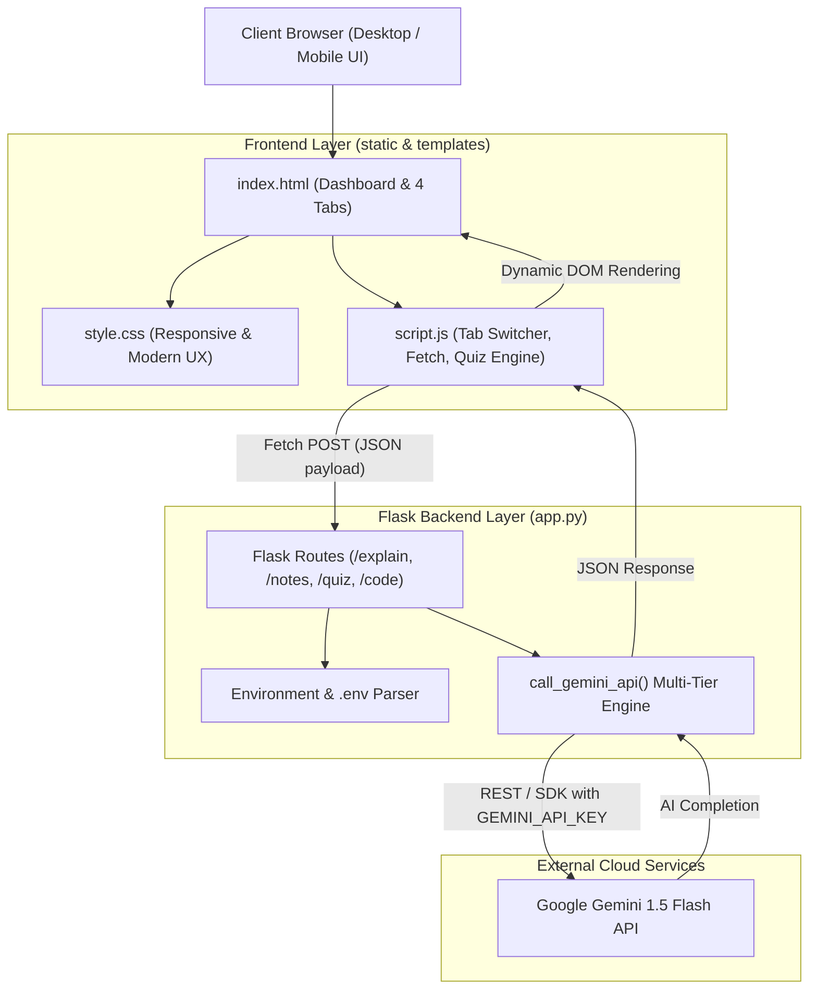

# AI Study Buddy – Project Architecture & Technical Documentation

**Application Name:** AI Study Buddy (Intelligent Learning Assistant)  
**Backend Framework:** Python 3.9+ Flask  
**Frontend Technologies:** Semantic HTML5, CSS3 Custom Properties, Vanilla JavaScript (ES6+)  
**AI Service:** Google Gemini API (`gemini-1.5-flash`) via `google-genai` / `google-generativeai` with Standard Library REST fallback  
**Environment Management:** `python-dotenv`  

---

## 1. System Architecture Overview



---

## 2. API Endpoint Specifications

### 1. `GET /`
- **Purpose:** Serves the main responsive single-page web dashboard.
- **Response:** Rendered HTML template (`templates/index.html`).

### 2. `GET /api/status`
- **Purpose:** Health check and live verification of API key configuration.
- **Response Format:**
```json
{
  "status": "online",
  "has_api_key": true,
  "sdk_mode": "google-genai"
}
```

### 3. `POST /explain`
- **Purpose:** Academic concept explainer with beginner-friendly formatting.
- **Request Body:**
```json
{ "topic": "Photosynthesis" }
```
- **Response:**
```json
{ "result": "Markdown formatted explanation with headings and examples..." }
```

### 4. `POST /notes`
- **Purpose:** Creates structured high-yield revision notes.
- **Request Body:**
```json
{ "topic": "Database Normalization" }
```
- **Response:**
```json
{ "result": "Structured bulleted study notes..." }
```

### 5. `POST /quiz`
- **Purpose:** Generates interactive 5-question multiple choice quiz with answer keys and explanations.
- **Request Body:**
```json
{ "topic": "Python Data Structures" }
```
- **Response Format:**
```json
{
  "quiz": [
    {
      "question": "Which data structure is immutable in Python?",
      "options": ["A) list", "B) tuple", "C) dict", "D) set"],
      "answer": "B) tuple",
      "explanation": "Tuples cannot be modified after creation."
    }
  ]
}
```

### 6. `POST /code`
- **Purpose:** Programming mentor for error diagnostics, concept explanations, and code solutions.
- **Request Body:**
```json
{ "query": "Why does list.sort() return None in Python?" }
```
- **Response:**
```json
{ "result": "Explanation of in-place mutation and example code..." }
```

---

## 3. Resilient Multi-Tier Gemini Integration

To guarantee that the application runs smoothly on any system—even before optional third-party SDKs are installed—`app.py` implements a 3-tier fallback architecture:

1. **Tier 1 (Modern Official SDK):** Checks for `from google import genai`.
2. **Tier 2 (Classic Official SDK):** Checks for `import google.generativeai as classic_genai`.
3. **Tier 3 (Zero-Dependency REST Fallback):** Uses Python's native `urllib.request` to communicate with the Google Generative Language API endpoint.

This ensures zero build failures regardless of virtual environment configuration.

---

## 4. Security & Best Practices

- **Zero Hardcoded Secrets:** Keys are never embedded in source code. `.env` is explicitly declared in `.gitignore`.
- **Validation:** Every route validates input payloads and returns `400 Bad Request` with meaningful error strings on blank submissions.
- **Graceful Error Handling:** If no API key is configured, the server returns a friendly `503 Service Unavailable` message instructing the student on how to set up their key rather than throwing an unhandled exception.
